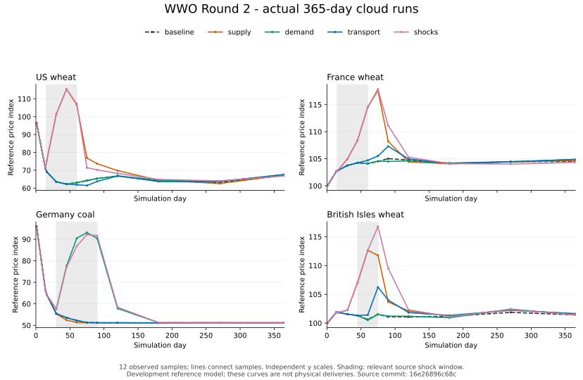

# WWO Economic Lab 第二轮综合报告

前七节保留第二轮历史结论；第八节记录有限实物流量，第九节记录公告锚定与新价订单；本轮外生供给冲击的数值传导见第十节，各阶段源码和运行分别列出。

结论：五项原生经济运行任务均完成了明确边界内的云端验收。**完整的“产业链—跨国采购—全球指数—企业实际改价”闭环为 CONDITIONAL，尚未全部贯通。** 本轮没有强迫 NPC 改价，也没有将宏观估计当成可交付库存。

验收仓库为 `ryoumiyahayato/wwo-economy`，分支 `sandbox/main`。最终综合验收源码为
`16e26896c68ccb788265dd5d7bc5f96bcf4b2dde`。
[最终 Actions 运行及 Summary](https://github.com/ryoumiyahayato/wwo-economy/actions/runs/40166426974)
为 **PASS**。本报告及数据是该验收之后的研究记录；并不声称报告提交本身又运行了经济模拟。

## 运行记录与版本

| 作业 | 准确提交 | 结果 | Linux job 耗时 |
|---|---|---|---:|
| [首个综合候选](https://github.com/ryoumiyahayato/wwo-economy/actions/runs/40165048380) | `d74af9ff056b5e95a87d2f2f3f1cadf63403816c` | PASS；长 annotation 被截断，Summary 保留 | 251 s |
| [下游扩展验收](https://github.com/ryoumiyahayato/wwo-economy/actions/runs/40165845708) | `b5aa99d9c741b3ddb09776bb961bc0efd09983c4` | FAILED；下游缺少自报价，原策略拒绝补货 | 375 s |
| [最终综合验收](https://github.com/ryoumiyahayato/wwo-economy/actions/runs/40166426974) | `16e26896c68ccb788265dd5d7bc5f96bcf4b2dde` | PASS；含实际 HTTP 桥接人物链 | 269 s |

仍只有原 `.github/workflows/economy-cloud-check.yml` 一个入口，新增手动选择 `round2-full`。
没有 schedule、push/PR 自动触发、自动下一轮、协调服务或后台重试。

## 一、Godot 云端世界：PASS

- Ubuntu 24.04 托管 Linux；Python **3.12.15**；Node 选择器 **24**；实际 Godot 为 **4.6.3.stable.official.7d41c59c4**。
- 校验并恢复 `01-source23.tar.gz` 及三个 `02-resources23-*` 卷，每次作业共 **2,170,635,398 bytes**；没有下载 `03-saves.tar.gz`。
- 原包先核对 SHA256；引擎使用固定官方 4.6.3 Linux 包及官方 SHA512。旧 Release 未修改或重新上传。
- 先恢复不可变 `baseline23/`，再应用当前源码覆盖层，记录每个改动路径的原包/候选 SHA256。候选差异见[证据 JSON](ROUND2_RESULTS_20261025.json)。
- 删除隔离工程的 `.godot` 后，执行真实无缓存导入。导入和加载日志检查通过；零退出码之外也检查了解析及运行错误。
- 原全球市场场景、球体/控制器及原商号均已实例化检查。商号接入新建 Formal 宿主，进入时 minute=0，未因 UI 加载推进世界。
- WorldBootstrap、原 GameClock、SimulationStep、Formal 生产、订单、StockLots、Ledger 和状态重建均在实际后续运行中使用。

第54/84/86日存档从未被读取、覆盖或推进。未操作用户 Windows，未修改主 WWO 或军事仓库。

## 二、365日全球指标与 Formal 对照

### 全球指标：PASS；历史真实性及整年微观经济：UNVERIFIED

五组各实际推进365日，保持 **50经济区域、16商品、120条稀疏联系**，调用原 `run_global_market.gd` 和原参考算法。新增 `benchmark50` 仅选择原有单份规模，不重写算法，也不额外运行十倍压力副本。

| 情景 | 最终作业计算耗时 | 类型化状态 bytes | 自身序列化后恢复 |
|---|---:|---:|---|
| 正常基线 | 11.589 s | 2,358,168 | PASS |
| 美国小麦减产 | 11.815 s | 2,351,116 | PASS |
| 德国煤需求增加 | 11.800 s | 2,353,152 | PASS |
| 英国估计通道受限 | 11.792 s | 2,352,100 | PASS |
| 三冲击组合 | 12.059 s | 2,356,988 | PASS |

计算合计 **59.056 s**。旧记录约8.58 s/单份年指标与本次硬件及运行条件不同，不能据此判断性能回退。第二、三次云端作业的已记录价格采样及选定市场末值一致；不将此扩大成跨作业全部逐日状态字节相同。

图中为第1、14、16、30、45、60、75、90、120、180、270、365日实际采样，折线仅连接采样点，子图纵轴独立。**这些是参考指数，不是国际货物交付。**

| 冲击与观察项 | 相对同日基线的最大采样价差 | 首个发生差异的采样日 |
|---|---:|---:|
| 减产：美国小麦 | +53.12718 | 16 |
| 减产：法国小麦 | +13.13709 | 30 |
| 减产：英国小麦 | +11.99798 | 30 |
| 需求：德国煤 | +41.78805 | 30 |
| 通道：英国小麦 | +4.72210 | 60 |
| 组合：英国小麦 | +15.26377 | 30 |

这是采样分辨率下的传导顺序，不是精确到日的首达时延。解除冲击后存在回落和振荡，未强制恢复同一状态。
第365日基线的美麦、法麦、德煤、英麦指数分别为 **67.01457 / 104.49798 / 51.19502 / 101.43030**；组合情景分别为 **66.85728 / 104.31942 / 51.19702 / 101.45862**。

基线末日的估计缓冲分别为 **15.76317 / 8.24507 / 34.14929 / 7.72117**，所列四市场在五种情景的末日未满足量均为0；这不证明全年每个市场都没有缺口。完整运行阶段记录了供需、缓冲及缺口采样，不能把末日零缺口当成全年零缺口。

正常情景下美国小麦和德国煤也明显跌价。模型使用显式开发产能、弹性、缓冲和滞后，缓冲积累会形成降价压力；它不是校准过的1900年价格预测。组合效果也不是三个冲击的线性相加，估计网络的共享容量和不同商品竞争可能使个别地区出现反向变化。原结果保留，没有为使曲线更符合直觉改输入。

### 同起点 Formal 30日对照：运行 PASS；指数改变实际经营：CONDITIONAL

新建原 ConsumerAccess 开发世界，预热24个完整日（minute **34560**），从同一快照分叉，再各运行30日。两个条件的初始快照哈希相同，恢复后账本、库存和时间一致。两组都使用原日期采购开关和相同成本观察配置。

| 观察项 | 旧历史记录 | 本轮关指数 | 本轮开指数 |
|---|---:|---:|---:|
| 食品厂现金 | 125→103 | 156→136 | 156→136 |
| 面包累计生产 | 96 | 102 | 102 |
| 期间粮食订单 | 各12 | 13 | 13 |
| 指数报价判断 | 9 | 0 | 10 |
| 指数驱动实际改价 | 0 | 0 | 0 |

本轮起点面包累计34、期末102，实际新增68。两条件期末主要库存同为面包9、面粉3、粮食0，已知售出成本窗口同为182、销售收入204、有限毛贡献22；这不是净利润，原始期初未知成本不会被事后填造。

**本轮没有读取旧玩家/试玩输入，因此不是旧结果的严格重放。** 原输入、暖机方式、配置与本轮不同，不能把现金136高于旧103称作经济改进。
指数信息链已经收到信息，实际改价及采购成本差异仍未出现。原报价规则同时检查自有库存、真实到货销售、资金拒绝及整数价格刻度：例如初价3时，不足约16.7%的指数涨幅可能尚不能取整为4。不能单凭信息送达推定某一条件已促成涨价；本轮保留零改价，未加入固定涨价百分比。

## 三、Gen23人物原生链：PASS

新适配器为 `private.wwo.gen23-economy.v2`，绑定精确候选 SHA、源码清单哈希及 Godot 4.6.3。
旧 `formal-economy.v1` 的固定提交 `b5bfcdd870da5d2b54f8a27e2abbfb9d511c502d` 检查保留。新增缺源、错误SHA、改动源码、错误引擎、空清单和独立插件加载保护测试；本地16项基础设施/来源测试通过。

最终验收通过真实 **loopback HTTP bridge → 原 Godot 宿主** 创建会话、提交本人操作和推进原时钟，未使用示范算法替身。
人物为合法生成的 `person:formal_generated_country_fra_0001`，起点巴黎，工作坊原生雇佣；只有本人收到的岗位和报价用于下令。

| 操作 | 原 minute | 实际证据 |
|---|---:|---|
| 身份与初始状态 | 0 | 原个人账户2500，开发世界初始资金 |
| 求职、工作 | 1440 | `round2:apply`、`round2:work` 原机制接受 |
| 工资入账 | 4320 | 6；`r1:wage:work:2:person:formal_generated_country_fra_0001:0` |
| 已知报价购买 | 7200 | `order:40`，肥皂1、价格8，原Ledger预留8 |
| 离开并返回巴黎 | 7200、10080 | 两个原旅行命令，各付旅费2 |
| 领取与付款 | 11520 | `shipment:40`、`round2:collect`，本人肥皂0→1，支付8 |
| 实际消费 | 11520 | `round2:consume`，本人肥皂1→0，原生活记录确认手动消费 |

付款交易为 `r1:goods:shipment:40`。最终现金 **2494 = 2500 + 6 − 8 − 4**，没有事后改余额。起始2500不是本轮工资，也不宣称人物从零资产只靠6单位工资买下8单位商品。重复购买命令验证幂等，不重复扣款。
复用原网页人物状态、差异与事件面板；原始货批/订单/生活事件来自原宿主，研究观测不赋予个人额外交易权限。

## 四、有限煤铁—钢材—下游订单：PASS（开发情景）

复用原工厂设备、劳动力、工资、Formal库存和生产器，配置 **煤2 + 铁矿1 → 钢1**，运行7日；材料为明确开发单位，不声称真实冶炼配比或吨位。

| 条件 | 初始煤/矿 | 产钢 | 实耗煤/矿 | 厂内余钢 | 下游收钢 | 企业现金 |
|---|---|---:|---|---:|---:|---|
| 充足 | 6 / 6 | 3 | 6 / 3 | 2 | 1 | 140→176 |
| 缺煤 | 0 / 6 | 0 | 0 / 0 | 0 | 0 | 140→188 |
| 缺铁矿 | 6 / 0 | 0 | 0 / 0 | 0 | 0 | 140→188 |

投入不足同时使生产和下游供货归零，没有宏观缓冲补料。实际货批包括煤 `portion:10`、铁矿 `portion:11`；耗用与余额核对一致，三组均通过原 Formal 快照重建。

充足组的下游是食品企业里昂仓库的显式有限备货目标，不冒称已有历史钢材客户或无限市场需求。其原生 `order:12` 已交付钢1，货款12由 `account:regional_food` 支付给 `account:regional_textile`，交易为 **`r1:goods:shipment:12`，minute5760**。
同城原运费为0，未重复扣运输容量。

第二次作业的下游目标没有自报价，被原可选补货策略拒绝；该失败记录保留。最终三组统一设置与本地到货成本相等的报价12，未修改采购断言、原材料数量、生产公式或NPC涨价规则来制造PASS。
充足组现金反而低于短缺组；现金包括工资及其他分店业务，不能将产钢或单笔收入等同利润，也不能凭该差额擅自分摊所有成本。

## 五、伦敦港→勒阿弗尔真实订单：PASS（有限开发合约）

原空间目录的航线为 `shipping_channel`，明确使用 **`place:port_london`** 而不是伦敦城市。
伦敦港归属 `british_empire`，勒阿弗尔港归属 `country_fra`；不静默把城市、港口和经济统计区域混用。

开发配置另行声明卖方、买方、承运人和有限初始库存，原航线提供拓扑；**地图连线本身没有被当作运输服务**。实际订单使用声明的2单位/日运力、2日航程及两个港口的吞吐限制。
三方以原 `denomination:formal_simulation_minor_v1` 同币合约结算，故本笔不需FX；不声称历史GBP/法郎兑换已验证。

- 卖方初始粮食12，买方0；`order:1` 接受数量2、单价4，原Ledger预留 **10**（货款8、运费2）。
- `shipment:1` 于 minute1441 观察为 TRANSIT；正式交付、付款发生在 **minute4320**，非硬编码立即交付。
- 卖方库存12→10，买方0→2；买方现金100→90，卖方40→48，承运人10→12。
- 货款凭据 **`r1:goods:shipment:1`**，运费凭据 **`r1:freight:shipment:1`**，都引用同一 `order:1`。
- 买卖库存守恒、现金总额守恒、重复命令幂等及原状态重建通过。货批保留开仓来源、分拆父子身份及订单关联，见 JSON。

## 六、已贯通的反馈与未贯通的边界

**PASS：** 原料数量变化 → 实际钢产出变化 → 可供货数量变化 → 已知合法报价下的有限备货决定 → 原订单、运输、交付与Ledger → 下游钢库存与双方现金变化。

**PASS：** 英国真实有限粮食 → 跨国Formal订单交付 → 法国港口实际库存 → 法国样本库存24→26。候选修复了原先会把英国库存也计入法国样本的问题；初始英国12单位被明确排除。

**CONDITIONAL：** 完整产业、跨国交易与全球价格闭环尚未连成一套。钢材开发单位尚无可核对的全球统计换算与样本权重；跨国到货目前更新了法国库存观察，不等同于已改变宏观供需计算或地方实际报价。全球缓冲与估计流仍不可支付、不可提取。

最值得继续的是将已验证的原生生产/到货证据按正确地点、商品单位和有依据的样本权重输入宏观观察，再检验延迟公开信号何时真正触发主体的原经营条件。应保留拒绝、现金约束和整数门槛，不强制NPC涨价。此为后续建议，本轮不继续执行。

## 七、界面及资源

原全球球体、地图控制器、原商号和人物网页面板保留。实际标签选择最多4个重点加选中地区，本轮两尺寸均选出5个；实物订单层与估计连线层分开。公开价格滞后2日，未暴露研究供给、缓冲或估计流。

**PASS：** 原场景与新宿主加载、标签筛选、公开/研究数据隔离、1440×900与390×844窗口设置下的布局读取。
**CONDITIONAL / UNVERIFIED：** 后者包含引擎逻辑坐标与窗口缩放，不能据此认证移动端可读性；没有真实浏览器逐按钮走查、移动设备GPU帧率或人工可玩性验收，也没有伪造截图。

最终脚本耗时 **253.839 s**，子进程CPU合计 **188.428 s**，最大子进程RSS **1,216,172 KiB（约1.16 GiB）**；这些不是整台runner峰值或账单。
三个有限作业合计 **895 s（14分55秒）**，每个作业内仅恢复一次资源并复用全部阶段；源码/资源包累计下载约 **6.51 GB**。没有大型上传，没有购买资源或修改计费计划。

已知Artifact配额已满，三个综合作业均跳过Artifact上传，没有重试或删除历史Artifact。主要证据为各次Summary、有限作业日志和可读取annotations；本仓库只保存约78 KB的审阅后测试世界证据与小型价格图。

本轮完成后停止；不启动第三轮、后台协调或定时实验。

## 八、有限粮食后续：计算与送达成立，实际改价及完整闭环仍未成立

### 版本、范围与实际作业

本次先确认初始工作区干净，环境原先处于旧 `work` 分支，随后切到唯一接续分支
`sandbox/main`，HEAD 为 `8014188c518ec0f558142f0c1cac3e5ee3b40be6`。
该提交相对第二轮验收源码还修改了恢复辅助程序，故没有把第二轮运行结论直接延用到本次。

实际运行源码为 **`dfff9bfbaa4a51fbb5007c789d517b58d87a5573`**，
[Actions 40169211922 第1次](https://github.com/ryoumiyahayato/wwo-economy/actions/runs/40169211922/attempts/1)
的局部 `grain-followup` 作业成功。由用户手动触发；经济世界只在 GitHub 托管 Linux 运行。
使用 Godot **4.6.3.stable.official.7d41c59c4**，同一作业内只恢复一次原源码及三卷资源，
共 **2,170,635,398 bytes**，保留原资源/引擎校验。没有生成新的候选指纹清单。

只执行第二轮决定原因重建和本次局部粮食比较：各世界预热24日，从合法起点运行30日。
不延长至60日；库存阻塞持续存在，没有为等待改价无限推进。没有运行 `round2-full`、
年度情景、煤铁钢、人物、UI、浏览器、移动性能或全量回归。没有读取玩家旧存档、
修改旧 Release、主 WWO 或军事仓库，也没有新建永久分支。

### 第二轮零改价的实际原因

历史精简结果遗漏了决定详情。局部作业取回不可变 `16e26896…` 的参考算法，
以原 ConsumerAccess 条件重建相同24日开发起点，只给现有决定补充字段；报价谓词未改。
食品企业现金156→136、原粮食订单13笔、累计面包34→102，与第二轮记录吻合。
这是新世界的有限重建，不能宣称重放了历史玩家存档或所有原状态字节。

目标为 `firm:regional_upstream`、`site:regional_upstream:lyon`。
下列10次中，**初价恒为3，当前价恒为1，取整目标恒为3，实际新价恒为1，现金拒绝恒为0**。
可售库存门槛为6，销量是原3日窗口内实际已交付数量；不是订单意向。

| 决定日 | 公告观察日 | 已接收日 | 指数 | 可售库存 | 已交付销量 | 同时未满足的条件 |
|---:|---:|---:|---:|---:|---:|---|
| 27 | 24 | 26 | 100.00 | 9 | 2 | 库存大于6 |
| 30 | 27 | 29 | 100.30 | 13 | 2 | 库存大于6 |
| 33 | 30 | 32 | 100.98 | 12 | 0 | 库存大于6；无实际销量 |
| 36 | 33 | 35 | 101.92 | 12 | 1 | 库存大于6 |
| 39 | 36 | 38 | 102.57 | 11 | 0 | 库存大于6；无实际销量 |
| 42 | 39 | 41 | 102.78 | 13 | 1 | 库存大于6 |
| 45 | 42 | 44 | 102.97 | 12 | 0 | 库存大于6；无实际销量 |
| 48 | 45 | 47 | 103.33 | 12 | 1 | 库存大于6 |
| 51 | 48 | 50 | 103.71 | 11 | 2 | 库存大于6 |
| 54 | 51 | 53 | 104.27 | 12 | 1 | 库存大于6 |

公告有效期均为接收日加3，决定日均在有效期内。公告服务仍延迟2日；原 SimulationStep
先完成企业当天决定，再完成当日参考结算，因此上述决定使用前一天已经接收的公告，
并非偷看当日新指数。没有发现必须修复的信息送达、采用或时间顺序错误。

**实际阻塞不是整数取整。** 当前价已经因原自有库存规则在预热期降至1，
取整目标3始终大于当前价1。10次均不满足指数分支的库存条件，其中3次还不满足销量条件。
原自身规则选择 `OWN_EXCESS_FREE_STOCK`，但 `max(1, old−tick)` 已在价格下限1，
所以也保持1。此前报告的“初价3约需16.7%涨幅才能取整为4”是算术例子，不是这10次决定的原因。
原销售授权、tick=1、公告传递、报价次日生效规则和订单锁价均保留。

### 单位、范围、权重及替换块

原商品目录确认小麦单位为吨、单位质量1000公斤。参考算法独立使用开发 `RATE[wheat]=180`，
并不使用目录中为0的 `base_daily_units_per_million`。本次明确其量纲为吨/百万人/日：
`base` 是固定的基准日吨量；`supply`、`demand` 和当日估计进口是每日结算区间的吨量；
`cover` 是剩余估计吨量除以 `base`，即基准需求日数，不是实际可交付库存，也不是按当前需求计算的覆盖天数。
价格为无量纲指数。日结算始终跟随原 GameClock。

- **换算：** 原生粮食的 `development_kg` / 1单位等于1公斤仍是开发语义，乘0.001才得到吨；换算不提供抽样依据。
- **范围：** 固定启用时已知的原生地点身份，按实际地点读取累计生产/耗用的边界差值；不把少量企业扩展为全国。
- **权重：** 1，逐单位采用，不提高权重以触发改价。
- **替换：** 在宏观中显式预留同一有限地点分区，以启用前完整观察日的日均量作开发基线；每天先减这部分，再放入该分区实际当日量。法国块为生产0.000500吨/日、耗用0.000458333吨/日。其全国统计代表性和与真实宏观估计的校准仍为 **CONDITIONAL / UNVERIFIED**；不能将这种开发分区声明称作已证实的全国份额。

后续30日进入该有限计算块的实际生产合计 **0.014吨**、耗用 **0.016吨**。
生产事实来自原生产器和物理累计记录，原生产器仍消耗 StockLots 输入并形成产出货源；
例如 `production:25:site:regional_upstream:lyon:activity:regional_grain:grain`
于 minute36000 形成2个开发公斤。观察器不改变生产、所有权或结算。
库存只从实际地点的原货批读取，排除 CARGO；库存存量不每天加入供给。

法国首个结算日 `base=7326` 吨/日，供给 **6252.742500** 吨、需求 **7325.999542** 吨。
2单位到货为0.002吨，只相当于基准日需求 **2.7300×10⁻⁷**、当日供给 **3.1986×10⁻⁷**。
在当前平滑公式下，即使假设能将它作为独立新增进口采用，首步指数作用也仅约 **10⁻⁷**，
远小于公开指数0.01精度；这只是量级估算，不是本次实际采用进口的结果，更不等于越过企业整数门槛。

### 真实跨境交付及重叠边界

伦敦城市 `place:london`、伦敦港 `place:port_london` 保持不同地点。
原港口目录中的父政体是 `british_empire`；本次只把这两个明确的伦敦地点对应到
原参考情景以伦敦为锚点的 `british_isles_1900` 经济统计区域，不将整个帝国归入英伦三岛。
勒阿弗尔使用港口地点及其 `country_fra` 归属。其他无依据映射返回未知，不归入法国。

同一世界中的有限 `order:108` 在 minute34560 接受粮食2、锁定单价4。
源货批 `portion:23` 为伦敦港12单位；其预留子批 `portion:699` 于 minute36000 离开源地点。
目的港第25、26日库存均为0；第27日 minute38880 的原回执 `shipment:108` 才确认交付2。
买方子批 `portion:767` 保留英国开仓货源和父批身份；卖方余10、买方实收2。

同一 minute38880，原Ledger支付货款8（`r1:goods:shipment:108`）和运费2
（`r1:freight:shipment:108`），均引用 `order:108`。观察器没有另行付款或交货，
没有产生现金、库存、运力或第二套结算。

现在只把商品为grain、来源/目的区域已知且不同、发生时间落在本次边界之后的回执记为跨境到货。
境内grain转手仍可观察，但不成为全国新增供给；其他商品交付不计作粮食。
旧字段 `delivered_all_goods_native_today` 不再作为新粮食口径。

**本笔宏观进口采用仍为 UNVERIFIED。** 估计流只有聚合商品/通道数量，缺少对应的原生合同覆盖标识。
无法证明本笔已经被哪部分估计进口覆盖，也无法据此排除重叠。故记录真实跨境交付0.002吨，
但采用进口贡献明确为 **0**，不叠加、不任意替换整个估计通道；本笔没有被归因为指数变化或企业改价原因。

### 局部因果比较与恢复

三个条件复用同一合法 minute34560 快照，资金、库存、合同、时间和既定冲击相同。
参考市场始终开启；实物比较只切换有限分区是否采用，公告比较只切换目标上游企业是否采用已收到信号。
独立研究开关在恢复后的比较续跑中按同一条件重新设置，不是新增经济权限。

- **有限实物分区→参考计算：PASS（开发假设范围内）。** 采用与不采用条件的法国小麦指数最大日采样差为 **0.000002031367**，发生在第51日。30日公开两位小数指数全部相同；粮食订单、Ledger付款和粮食报价回执逐项相同。不能把这一细小差异归给未采用的跨境到货。
- **公告实际送达：PASS。** 原延迟公告有效送达，上表列出10次实际采用时可读的公告。只忽略目标信号的条件中，法国小麦30日全部记录的cell与采用条件相同，粮食订单、付款、报价回执也相同。
- **公告→实际改价：CONDITIONAL，未发生。** 相同的库存与销量条件阻塞，指数驱动改价为0。原减产冲击仍存在，但本次连“外生指数影响实际报价”也未观察到，不能作更强归因。
- **新指数报价→订单→交付→付款：未贯通。** 三个条件各有14笔观察期grain订单记录，含1笔跨境单及13笔食品补料单；其中末笔仍未交付。`order:106` 和港口 `order:108` 已在共同起点快照内；14笔是 `accepted_minute>=34560` 的记录口径，不能全称为分叉后新订单。已有实际交付和付款，但没有任何订单可以归为使用本次指数驱动新价。

三个条件均通过同边界重复观察/重复结算、重复已接受港口命令、零分钟推进不改变状态。
第30日快照再恢复并续跑1日，与不中断路径第31日的经济、原生经济、Ledger、时间及组织责任状态相同；
此处“第30/31日”是世界绝对日，位于30日观察期内部，并未延长观察期。
期末原状态重建相同，旧订单价格在后续公告期间保持锁定。
旧格式兼容用当前合法世界构造旧local字段形状，确认恢复后不回补新样本或重复采用最后一天流量；
不声称已验证所有历史玩家存档。

原有失败记录全部保留。作业脚本耗时 **154.105 s**，子进程CPU合计约132.705 s，
最大子进程RSS **1,216,036 KiB**；不是整台runner峰值或账单。
已知Artifact配额问题继续记录，本次直接跳过上传，没有重试、删除历史附件或更改计费。
局部结果复用原结果JSON的 `grain_followup_20261025` 节；完整原始观察仍可由实际作业日志读取，
没有建立新证据包、验收矩阵或脚本体系。

### 独立配置问题：stale_base 未解决

云环境配置持久化的 `stale_base` **仍为未解决**。本次观察到配置版本3、4，但
`allowed_hosts` 仍为空，云执行器访问 `api.github.com` 持续返回Forbidden。
配置版本推进不等于确认原持久化问题已解决；最终由用户手动触发局部Actions。
这一配置状态不参与上面的经济结果判定。

本次有限后续到此停止；不自动开始下一轮，不发布或同步到主WWO。

## 九、粮食公告锚定影响报价并进入真实订单；指数数值上涨的影响未成立

### 接续版本与预先判断

本轮开始时 `sandbox/main`、工作区干净，HEAD及远端均为
`0f97ad8b06f1cce806a8bdd5d44f70667551a7c3`，没有其他新增修改。
本轮实际源码 **`f39d838b788c89f72d7e229a610b90330ff2609a`**，
[局部作业40171913299](https://github.com/ryoumiyahayato/wwo-economy/actions/runs/40171913299)
成功。没有把旧提交的作业结果当作本轮源码验证。

先核对原生产、采购和交付关系：上游grain计划需求为成品目标库存加已承诺/收到的请求，
再加 `ceil(近期接单量/观察天数) × 4日规划期`，扣除库存与已接受在途敞口。
食品厂按真实磨粉、烘焙缺口采购；其粮食耗用经原配方生成面粉、面包，再由原需求购买和消费。
少量订单的向上取整覆盖与原8单位缓冲相加，生产器会主动补充库存；这解释了旧情景的9至13单位可售量。
不是库存条件写错，也不能把旧30日未到达扩大为任何需求冲击下都不可能到达。

因此运行前在原 `docs/ECONOMY_ROUND2.md` 声明**唯一经营变体**：原Consumer开局只把
上游grain额外成品缓冲目标8改为0，表示按已知订单生产；开仓grain仍为8、价格锚3、
企业现金220、每批产粮2、劳动、产能、4日规划期及全部买方需求和采购规则不变。
没有删除开仓资产或运行中库存，也没有暂停生产。两个比较条件复用同一预热24日后的合法快照，
其现金、库存、合同、时间、参考市场及冲击相同；只切换目标企业是否采用已收到的指数。
共同运输配置使用原合法命令，之后的生产、买入、交付、消费和报价均由原企业机制自主执行。
未在运行后调节开局或延长时间寻求预期结果；旧情景结果保留，本次不重跑旧情景。

本变体预热自行形成不同价格路径：minute34560快照中现行价是4，已发布次日生效的3。
这与旧情景现价1不同。前24日尚未开启参考市场，不能将这些预热改价归因于指数。
观察期的第27日决定使用现价3。当前条件下实际可售库存为2至5，采用组10次决定中7次
同时满足库存、近期交付及零现金拒绝条件；第30、36、42日因窗口内没有已交付销量，仍不能采用。

### 同一报价函数分离三种来源

原报价计算提取为唯一 `quotation_step`，原NPC与脱离交易世界的归因计算调用同一函数。
原优先级、库存上限6、销量门槛、现金拒绝、tick=1、权限、通知及生效时间没有放宽。
中性数值100只参与同输入计算，不被构造成公告，不写入参考市场，也没有建立中性交易世界。
旧10次实际记录也经此函数计算：真实收到指数与100均保持价1，原库存阻塞仍成立。

本轮两个交易世界的30个法国小麦日参考值、已送达公告序列和已记录的生产/耗用/库存量逐项相同。
首次报价路径差异发生在**世界第33日，minute47520**：

| 同一决定输入 | 值 |
|---|---|
| 企业/地点 | `firm:regional_upstream` / `site:regional_upstream:lyon` |
| 初始价格锚 / 当前价 | 3 / 2 |
| 可售库存 / 规则上限 | 4 / 6 |
| 3日窗口实际已交付销量 / 现金拒绝 | 1 / 0 |
| 实际公告 | 观察第30日、接收第32日、有效至第35日；指数100.98 |
| 自身规则结果 | 保持2，`HOLD_INSUFFICIENT_OWN_EVIDENCE` |
| 中性100的取整目标 / 单步输出 | 3 / 3 |
| 真实100.98的取整目标 / 单步输出 | 3 / 3 |
| 实际采用组 / 忽略组发布价 | 3 / 2 |

这是**收到公告后向开局价格锚回升**。它证明公告采用影响报价，但真实指数数值100.98
相对100没有改变取整目标或单步结果，不能称作“指数上涨推动涨价”。

| 决定日 | 可售库存 | 已交付销量 | 已收到指数 | 采用组输出 | 忽略组输出 | 主要原因 |
|---:|---:|---:|---:|---:|---:|---|
| 27 | 5 | 1 | 100.00 | 2 | 2 | 自身库存规则降价；指数目标3等于当时现价3，不覆盖该规则 |
| 30 | 4 | 0 | 100.30 | 2 | 2 | 无近期实际交付 |
| 33 | 4 | 1 | 100.98 | 3 | 2 | 公告锚定回升首次造成组间差异 |
| 36 | 2 | 0 | 101.92 | 3 | 2 | 无近期实际交付 |
| 39 | 4 | 2 | 102.57 | 3 | 2 | 采用组已达目标3；忽略组自身规则保持2 |
| 42 | 3 | 0 | 102.78 | 3 | 2 | 无近期实际交付 |
| 45 | 4 | 1 | 102.97 | 3 | 2 | 同上，已达目标 / 自身保持 |
| 48 | 2 | 1 | 103.33 | 3 | 2 | 同上 |
| 51 | 3 | 2 | 103.71 | 3 | 2 | 同上 |
| 54 | 4 | 3 | 104.27 | 3 | 2 | 同上 |

现金拒绝全部为0。第27日3→2是自身规则的改价；第33日2→3是公告采用产生的锚定回升；
**本轮没有指数数值变化引起的单步或实际报价路径差异。** 两组全部20次同输入归因中，
真实指数和100都得到目标3，并输出同一价格。

整数门槛是本轮数值归因的具体限制：锚3需公开指数至少116.67才取整到4，决定实际读取的最大指数104.27未跨过。
跨过取整边界也不自动构成报价差异：若现价低于两个目标，原算法每次只上调一个tick，
前几次输出仍可能相同；还需要在条件同时满足时，现价与不同目标的关系使原分支输出不同。
本轮不注入更高指数、不调刻度，也不继续推进等待跨界。

### 新价原生订单、交付与付款

首次差异发布的是 **`goods_quote:site:regional_upstream:lyon:grain:11`**，单价3，
原销售授权 `DEVELOPMENT_FIRM_SALES_MANDATE`。对应链条为：

| 事件 | 世界日 / minute | 原机制记录 |
|---|---|---|
| 报价发布 | 33 / 47520 | 原NPC `post_goods_quote` 成功，报价版本11 |
| 报价生效 | 34 / 48960 | 原次日生效规则；该日买方仍只持有旧版本10，观察为 `GOODS_QUOTE_SUPERSEDED`，可买数量0 |
| 通知送达食品厂 | 35 / 50400 | `notice:goods_quote:site:regional_upstream:lyon:grain:11:site:regional_food:paris`；原供应商信息为来源 |
| 新订单接受并锁价 | 36 / 51840 | `order:158`，买方 `firm:regional_food`，粮食2，锁价3；原采购命令 `source=firm`，非外部脚本下单 |
| 资金及货批预留 | 36 / 51840 | `account:regional_food` 原Ledger预留8＝货款6＋运费2；原 `portion:1045` 预留粮食2并进入运输，货源为第23日原生产批 |
| 原物流交付 | 38 / 54720 | `shipment:158`，原里昂→巴黎路线、2日行程，交付2 |
| 货款及运费结算 | 38 / 54720 | `r1:goods:shipment:158` 支付6给上游；`r1:freight:shipment:158` 支付2给原承运账户，均引用 `order:158` |

买方收到且有效的版本与接受时当前版本相同；受理时间晚于生效和通知。没有缩短信息延迟或强制成交。
对照世界同一时间的对应 `order:158` 锁价2、货款4、运费2；这笔实际货款差异来自公告锚定产生的报价差异。
没有使用伦敦港原价4的订单代替此证明。

每组观察期新接受该上游grain订单8笔，共11单位；7笔已交付共10单位，最后第54日订单尚未交付。
采用组实际货款29、忽略组20，实际运费均为10；没有把未交付的最后1单位算作付款。
未见被提交后拒绝的grain买单；第34日未收到新版本导致的零可买量，已作为实际可用性限制保留。
旧合同价格在每天核对中保持不变，包括共同快照内原锁价4、仍在途的 `order:101`。

### 检查范围与分别判定

两组均通过：零分钟推进与重复同时间边界不改变状态；重复已接受采购命令不重复预留；
重复原Ledger付款ID不再扣款；既有订单不因后续报价重新定价。
绝对第30日保存后续跑至31日，与不中断路径一致；该续跑点在首次差异之前。
第54日末快照包含新价报价和订单，并通过原样恢复；没有另做“首次新价结算中途断点恢复后再推进”的专项运行。
因此不能把恢复检查范围扩大到没有实际运行的断点。

- **公告采用影响报价：PASS，限预先声明的有限经营情景。** 第33日首次2→3，对照保持2。
- **指数数值变化影响报价：本轮未成立。** 100至104.27与中性100的目标、单步结果相同；没有证明更大指数变化下也无效果。
- **采用后新价成交、交付、付款：PASS，限 `order:158` 的原生链。** 该新价来自公告锚定；不是已证实的指数涨幅传导。
- **全国经济反馈闭环：UNVERIFIED。** 本轮没有做全国统计校准，也不将有限经营机制外推为全国实证。

Godot **4.6.3.stable.official.7d41c59c4**，候选作业内一次恢复原资源，共2,170,635,398 bytes，
保留工具原有完整性校验，没有主动生成或比对新指纹。脚本耗时110.480 s，子进程CPU约82.062 s，
最大子进程RSS 1,203,952 KiB；不是整台runner峰值或账单。

期间界面先重跑了旧作业：[40169211922 第2次](https://github.com/ryoumiyahayato/wwo-economy/actions/runs/40169211922/attempts/2)，
仍为旧源码 `dfff9bf…`，结果成功、耗时150.143 s；保留此记录，但不用于本轮归因。
该旧重跑也恢复一次同样资源，因此期间两个作业实际共恢复4,341,270,796 bytes；不是更换情景或反复调参。
两次都跳过Artifact上传，没有上传重试、删除附件或改计费。

候选作业未运行 `round2-full`、旧情景经济重建、365日情景、煤铁钢、人物、地图、UI、EXE或全仓库回归。上面另列的旧源码重跑确实执行了其原有决定原因重建及实物流量条件，不隐去这次额外运行。
0.001换算、有限地点权重1、未知进口覆盖处理及原Runtime、Ledger、StockLots、物流和存档机制保持原边界。
报告更新不重跑经济模拟。原结果JSON新增 `grain_quote_causality_20261025` 节，仍复用原入口与结果格式。

**独立配置记录：`stale_base` 仍未解决。** 最近环境版本10的API访问仍为Forbidden，
本轮由用户从工作流入口手动触发；不能用Actions成功代替配置持久化问题的解决证据。

本轮提交报告后停止，不继续构造情景、不发布、不同步到主WWO。

## 十、外生法国小麦供给冲击：数值改变实际发布价，固定窗口内尚无该新价订单

本轮接续 `sandbox/main`，起点工作区干净，HEAD与远端均为
`b1cebe9c9c07d3e2363208a2764bf8763235b682`；相对已运行 `f39d838…` 只有报告和结果更新。
本轮已运行源码为 **`8da26e633ddb43c937dcc0bc2894e0103b86f30d`**，
[新作业40174199425，第1次](https://github.com/ryoumiyahayato/wwo-economy/actions/runs/40174199425)
成功，实际检出提交与候选一致，没有重跑旧作业代替新源码验证。

### 固定实验及恢复约束

沿用上一轮零额外grain缓冲经营条件：开仓资产、价格锚3、tick1、劳动、产能、买方需求、
采购规则、报价条件及通知延迟不改。只研究 `firm:regional_upstream`、
`site:regional_upstream:lyon` 的grain报价；两组均采用实际收到且有效的公告。
同一合法第24日预热快照分叉，在推进前分别初始化参考市场：初始cells、历史、缓冲、队列、
地点样本及原三项冲击完全相同，唯一实验差异是处理组额外声明的事件。

对照使用原 `shocks`，处理使用显式 `shocks_french_wheat`。它保留原美国减产、德国煤需求、
英国估计通道事件，仅追加法国 `country_fra` 的 `wheat` 供给系数 **0.45**，
`from=start_day+15`、`until=start_day+60`，沿用原 `[from,until)` 规则。
启用日为世界第24日，额外事件因此在 **第39日至第84日前**生效。
设定在运行前已写入原 `docs/ECONOMY_ROUND2.md`；没有按结果改变系数、日期或经营条件。
这是开发压力情景，不是历史统计或真实法国农作物减产事实。

事件只在参考初始化时声明，不修改运行中的 `data.shocks`、指数、历史价格、公告或企业报价。
原恢复逻辑仍按情景重建完整事件列表并逐项核对；新增选项纳入原情景校验。
`quotation_step` 未改，0.001换算、有限地点权重1、未知进口覆盖处理也未改。
冲击直接改变宏观估计供给，不删除任何原生库存或产能，不产生资金、货物或结算权限。

### 冲击实际改变了哪些已送达数值

第39日法国小麦估计供给由对照 **6276.227841** 变为处理 **2824.302345** 吨/日，
原有限地点替换公式仍保留；当日参考价分别为102.784613与105.008219。
两日后的第41日，目标企业首次收到不同数值的原公告：

| 同时送达的公告 | 对照 | 处理 |
|---|---:|---:|
| 观察日 | 39 | 39 |
| 接收日 | 41 | 41 |
| 失效日（不含） | 44 | 44 |
| 指数 | 102.78 | 105.01 |

原生企业经营状态在该时点没有变化。比较覆盖原生库存/货批、合同、订单、运输、生产计划、
耗用、劳动、工资等持久状态及Ledger；仅排除报价本身和解释性decision元数据。
该比较在整个窗口内都相同，Ledger也逐日相同，因此首次发布价分歧前没有其他已观察的原生经营差异。
第33日双方仍共同出现原有的2→3锚定回升，上轮结论保留。

### 首次数值导致的报价分歧

| 决定日 | 对照/处理实际读取的指数 | 可售库存 | 已交付销量 | 对照/处理取整目标 | 对照/处理发布价 |
|---:|---|---:|---:|---|---|
| 39 | 102.57 / 102.57 | 4 | 2 | 3 / 3 | 3 / 3 |
| 42 | 102.78 / 105.01 | 3 | 0 | 3 / 3 | 3 / 3 |
| 45 | 102.97 / 110.24 | 4 | 1 | 3 / 3 | 3 / 3 |
| 48 | 103.33 / 113.66 | 2 | 1 | 3 / 3 | 3 / 3 |
| 51 | 103.71 / 116.15 | 3 | 2 | 3 / 3 | 3 / 3 |
| **54** | **104.27 / 118.11** | **4** | **3** | **3 / 4** | **3 / 4** |

上表现金拒绝均为0，销量来自原3日窗口内实际交付。第42日还受到零销量约束；
第45、48、51日的处理指数虽不同，仍未跨过锚3取整到4所需的116.67边界。
第51日结算后才送达另一条指数116.78的公告（观察49、接收51、失效54），
晚于第51日企业决定；下一次报价决定在第54日，使用更新且仍有效的公告。

首次可归因差异为**第54日，minute77760**。两组决定前均为现价3、可售4、
已交付3、现金拒绝0，价格锚与规则也相同；此前的其他原生经营和现金状态一致。
该次两组实际读取的公告均观察第51日、接收第53日、失效第56日。
固定这些同一原生输入，唯一 `quotation_step` 得到：

| 归因输入数值 | 取整目标 | 单步结果 | 原因 |
|---|---:|---:|---|
| 对照实际公告104.27 | 3 | 3 | 自身规则保持 |
| 处理实际公告118.11 | 4 | 4 | `DELAYED_PUBLIC_INDEX_AND_OWN_SALES` |
| 中性100，仅脱离世界计算 | 3 | 3 | 自身规则保持 |

数值差异同时改变了原函数输出和企业实际发布结果，tick仍为1，没有靠跳过刻度获得差异。
本次可以归因为额外外生供给事件经公告数值传到**实际报价发布**；第九节仅由公告存在引起的
锚定回升与此次机制不同。对照公告和中性100都没有促成这次3→4。

### 为什么没有新价订单及新订单恢复续跑

处理组已成功发布 **`goods_quote:site:regional_upstream:lyon:grain:18`**，价格4，
`posted_minute=77760`，`effective_day=55`，`expires_day=85`。
对照同版本发布价格3、日期相同。此为已授权的未来报价，不能将发布当成已经生效或送达买方。

| 环节 | 实际状态 |
|---|---|
| 第54日发布3/4的分歧报价 | 已发生，原NPC命令接受 |
| 第55日生效 | 由原报价条款安排，超出本轮实际推进范围 |
| 第56日买方通知 | 原2日通知规则的计划日期；窗口内没有该版本的接收回执 |
| 新价4被订单采用 | 未发生，不能判断买方届时会接受还是拒绝 |
| 新价订单交付与付款 | 未发生 |
| 新价已受理未交付订单的恢复续跑 | 条件未触发，UNVERIFIED |

两组均固定观察第25—54日共30日。本轮**没有**将窗口延长到第55或56日。
原采购器在第54日受理的 `order:214` 是grain1、锁价3、使用已知版本17，
原Ledger预留4＝货款3＋运费1，已经在途，尚未交付。其采购发生在同日较早的原采购阶段，
之后才发布版本18；版本18还未生效，绝不能把该订单改填为4或称作新价成交。
它的原货批为 `portion:1478`、关联第49日生产货源，未生成额外库存。

双方观察期该上游新订单8笔、共11单位，已交付7笔共10单位；实际货款均29、运费均10。
订单、交付回执与付款记录逐项相同，没有已提交后被拒绝的grain买单。
新价链条在本窗口停止于**发布后尚待生效与通知的时间边界**，不是已证明买方拒绝、库存不足或现金不足。

原订单锁价、重复已接受命令不重复预留、同时间边界及零分钟不重复交货、原付款ID不重复扣款均通过。
第54日原存档快照包含额外事件、未来4价及旧3价在途合同，两组均原样恢复。
但没有符合条件的新价订单，预备的“新价受理时恢复后继续，与不中断路径比较”没有执行，
不能把一般期末恢复结果称作新价订单恢复续跑通过。

### 四项判定与剩余边界

- **供给冲击改变已送达公告数值：PASS。** 首次为第41日，102.78对105.01。
- **数值改变实际企业报价：PASS至发布阶段。** 首次第54日，同输入原函数输出及原企业发布价均为3对4；新报价生效尚未实际推进。
- **该数值新价进入订单、交付、付款：未成立 / UNVERIFIED。** 固定窗口结束时尚未生效，也未送达买方。
- **该新价订单恢复后与不中断路径一致：未触发 / UNVERIFIED。** 没有新价订单可用于此项比较。

只支持开发模型内的外生冲击→已送达数值→企业发布价这一段传导。
有限实物样本反馈、全国统计代表性、真实历史减产及完整经济反馈闭环继续单列为CONDITIONAL / UNVERIFIED，
不能由本次发布价差异宣布完成。没有拿已有3价或伦敦港4价订单替代新链条。

### 运行范围与独立配置记录

Godot **4.6.3.stable.official.7d41c59c4**，一次新作业内仅恢复一次原源码与三卷资源，
共2,170,635,398 bytes，保留工具自带完整性校验；没有主动计算新哈希或生成指纹清单。
脚本耗时106.947 s，子进程CPU约84.918 s，最大子进程RSS1,420,596 KiB；不是整台runner峰值或账单。
本轮只有此一次作业，未调参重跑。报告更新不重跑模拟；Artifact直接跳过，没有上传重试、删除附件或更改计费。
未运行年度情景、煤铁钢专项、人物链、地图/UI/EXE检查、全量测试或全仓库回归。
继续复用原粮食入口和结果JSON的 `grain_supply_value_20261025` 节，没有新增验证脚本、探针、矩阵或证据包。

**`stale_base` 仍为独立的未解决配置问题。** 本轮环境版本12仍没有允许GitHub API的自定义域名，
终端API请求返回Forbidden；用户通过原工作流入口手动新建本次运行。
经济作业成功不等于配置持久化问题得到解决。

本轮提交报告后停止，不发布、不同步主WWO、不自动开始下一轮。

## 十一、同一法国小麦供给冲击延长至第62日：新价原单交付、付款及内存恢复续跑成立

### 续接来源、实际版本与固定边界

本轮初始 `work` 分支干净，HEAD为 `f39d838…`。取回远端后确认
`sandbox/main` 为指定报告提交 **`71525fc57329dd0e1045b17e68472721a9492848`**，
该提交之后没有其他远端提交；其相对初始本地分支的三个既有提交完整保留，随后切到
`sandbox/main`。此前实际运行源码仍为 `8da26e633ddb43c937dcc0bc2894e0103b86f30d`。

先查原运行代码、当前工作区和上次Actions附件：原第54日完整快照仅用于进程内
`restore_candidate(snapshot)` 检查，没有写盘；上次运行无Artifact，工作区未找到可恢复
第54日完整存档。因此本次为**重建后延长**，不是“接续上轮磁盘存档”。
在唯一一次局部作业内，按原代码和条件重建第24日共同起点及第25—54日前缀，随后观察
第55—62日。运行前已在原范围说明及脚本中固定共同截止日62，总观察38日，新增8日；
没有因订单或付款情况调整截止时间，也没有运行别的情景。

本轮实际运行源码为 **`ccae9392465048dc44c884070a70ade8c990c15c`**；
[Actions 40176290908，第1次](https://github.com/ryoumiyahayato/wwo-economy/actions/runs/40176290908)
检出此提交，唯一一次 `grain-followup` 作业成功。改动限于原局部脚本的延长、订单跟踪及
原说明/报告/结果JSON；没有修改生产、劳动、买方需求、采购规则、报价函数、通知延迟或环境配置。
两组继续采用实际收到的有效公告；对照 `shocks`，处理 `shocks_french_wheat`，法国小麦
供给系数0.45、原第39日至84日前区间不变。零额外grain缓冲、开仓资产、锚3、tick1均保留。

第54日两组均先核对通过：实际发布版本18，对照3、处理4，发布时间77760；
`order:214` 锁价3、粮食1，命令引用版本17且已在途。首次同输入数值分歧仍为第54日：
对照实际公告104.27和中性100输出3，处理实际118.11输出4。未将不一致重建当成同一实验继续。

### 原报价18的实际采用、交付与付款

重点原报价为 **`goods_quote:site:regional_upstream:lyon:grain:18`**。
以下日期均为本次实际推进后的原记录，通知日期由 `_receipts` 中已经存在的接收回执确认。

| 环节 | 世界日 / minute | 实际记录 |
|---|---|---|
| 报价生效 | 55 / 79200 | 处理组原 `current` 已为版本18、价格4；买方此时只知17，原可用性码为 `GOODS_QUOTE_SUPERSEDED` |
| 买方实际收到 | 56 / 80640 | `notice:goods_quote:site:regional_upstream:lyon:grain:18:site:regional_food:paris` 已在接收回执；`delivery_day=56`，观察日54，来源为原供应商信息回执 |
| 原采购器受理 | 57 / 82080 | `order:223`，`firm:regional_food`，grain1，锁价4，命令 `source=firm`、`reason=ACCEPTED`，实际引用原版本18 |
| 资金与货批预留 | 57 / 82080 | 原Ledger为 `account:regional_food` 预留5＝货款4＋运费1；原 `portion:1550` 预留1，父批 `portion:1381`，货源为第51日原生产批 |
| 原物流交付 | 59 / 84960 | `shipment:223`，第57日出发，里昂→巴黎原路线及2日行程，实际交付1 |
| 原Ledger付款 | 59 / 84960 | `r1:goods:shipment:223` 付4至 `account:regional_upstream`；`r1:freight:shipment:223` 付1至 `account:regional_development_transport`，均引用 `order:223` |

采购动作完整ID为
`auto:firm:regional_food:57:buy:site:regional_food:paris|site:regional_upstream:lyon|grain|edge:regional:lyon:paris|dated:1`。
其原复合 `payload.quote_id` 末段就是上述版本18，`max_price=4`、`quantity=1`；接收版本、
实际有效版本及订单引用一致。预留子批已由原发运机制移走1，不将其剩余0误读为没有预留。
没有由脚本代买、补钱补货或直接改价。对照同期对应订单引用同版本18，但锁价3、预留4，
第59日实际货款3、运费1；该差异对应原数值造成的第54日报价分歧。

旧 **`order:214`** 仍锁价3，第56日实际交付1，原
`r1:goods:shipment:214` 支付3、`r1:freight:shipment:214` 支付1，minute80640。
这笔旧单在版本18送达当天履约，不能算作4价成交。

### 自然分化、未提交日期及后续版本

第57日原新价订单受理后，两组原生经营快照与Ledger开始不同；脚本只记录这种差异，
没有继续要求两组相同或重新对齐世界。恢复比较始终使用处理组自己的不中断路径。
本窗口采购数量和节奏恰好仍相同，不因此把现金状态写成相同。

原采购决定记录显示，常规库存目标缺口与原时序采购器的可恢复未来生产缺口不同，
不能看到 `regular_quantity>0` 就推定应当提交采购：

- 第55日只知17，当前18已经生效；原单单位可用性记录为 `GOODS_QUOTE_SUPERSEDED`，候选为空；既有在途1也覆盖下一已知生产需要，`uncovered_future_quantity=0`，没有实际提交。
- 第56日已经收到18，原只读单单位受理观察为 `can_order=true`、`OFFER`；但原时序投影没有未来生产requirements，`uncovered_future_quantity=0`、候选为空，没有提交。不能说尚未知价、拒买4价或现金不足。
- 第57日原投影出现第58日生产缺口1，采购器才提交并接受 `order:223`。计划需要日58不是保证到货日；实际交付为59，原记录还保留了错过的生产量，没有改写成按计划准时到货。
- 第58日版本19已取代18、买方仍知18，原码再次为 `GOODS_QUOTE_SUPERSEDED`；在途1覆盖下一需要。第59日已知19，但未来缺口为0，未提交；第60日新缺口1触发受理。
- 第61日版本20已取代19、买方仍知19，未来尚有缺口1，但原码为 `GOODS_QUOTE_SUPERSEDED`、候选为空，未提交；第62日实际收到20，原采购器提交1。

两组原 `grain_refusals` 均为空：上述可用性码是采购前原观察结果，不是已提交订单的拒绝码。
本轮没有“提交后被拒绝”的grain买单，也没有把未提交说成领域拒绝。

处理组版本19于第57日发布、生效58、买方接收59；版本20于第60日发布、生效61、接收62。
两次原决定均为4→4、`HOLD_INSUFFICIENT_OWN_EVIDENCE`，实际读取指数120.24、123.18；
它们连续保留第54日数值造成的4价，没有中间改价，属于原版本18的保持价后继。
对照同期连续保持3。后继并不是两次新的同输入数值涨价，也不只凭单价4判断归因。
最先贯通的 `order:223` 直接采用18，本项证明无需依赖后继推断。

- `order:231`：第60日采用版本19、锁价4、数量1、预留5；源预留子批 `portion:1617`，第62日 `shipment:231` 实际交付1，原Ledger货款4、运费1均在minute89280支付。
- `order:235`：第62日采用版本20、锁价4、数量1、预留5；源预留子批 `portion:1653`，截止时 `transit=1`、`delivered=0`，无交付回执或付款。停止于62日，没有等到交付。

第25—62日该上游订单口径下，实际货款对照38、处理40，实际运费均13；
其中原版本18及保持价后继的新订单已付货款为对照6、处理8、运费均2。
末笔在途新单不计入已付金额。

### 只对新价原单建立恢复路径

恢复目标实际触发为处理组 **`order:223`**。第57日minute82080受理和发运后、尚未交付时，
其 `pending=0`、`transit=1`、`delivered=0`，资金预留5。此时调用原
`persistence.snapshot()` → `FormalPersistence.restore_candidate()`，恢复后只重新启用原
非持久化时序采购研究开关，其他原生状态及额外事件保持同一条件。

这是**本次进程内的内存快照恢复**，没有写盘再读回；不声称磁盘存档续跑通过。
恢复当时逐项相同，并与该处理组不中断路径共同推进至第62日；第58、59、60、61、62日逐边界比较
`total_minutes`、完整 `economy`、完整 `economy_native`、`ledger` 及组织责任状态全部相同。
完整原生快照比较涵盖订单、`stock_lots`、货运批次、运输、共享运输、货物履约、交付回执及
采购预留/结算记录；Ledger比较涵盖账户、资金预留与全部交易，而非只比最终订单数字。
第59日交付付款及第62日目标订单 `delivered=1`、`transit=0`、锁价4、资金预留已清除均一致。

既有重复已接受买单命令在两路径的恢复建立点不增加订单或预留；零分钟推进、同时间边界
不重复交货或结算。期末在两路径重放原Ledger付款ID均不再次扣款，包括目标单的货款及运费；
原锁价检查和两组期末原样恢复检查均通过。没有重复预留、交货或付款的观察结果。
只建立这一个符合条件的新价订单恢复分支，没有为旧 `order:214` 冒称新价专项恢复。

四项分别判定：原报价18实际生效并送达 **PASS**；数值导致的新价进入原采购订单 **PASS**；
该订单实际交付并按锁价付货款及运费 **PASS**；该订单内存快照恢复续跑与不中断路径一致 **PASS**。
这些结论仅证明此开发情景内的外生信号传导、交易及恢复链。
有限实物样本反馈、全国统计代表性、全国经济闭环仍为 **CONDITIONAL / UNVERIFIED**。

### 作业限制及独立配置记录

Godot **4.6.3.stable.official.7d41c59c4**；唯一作业只恢复一次原源码和三卷资源，
共2,170,635,398 bytes，沿用工具已有完整性校验；未主动计算或比对哈希、未生成指纹清单。
脚本耗时149.075 s，子进程CPU约97.995 s、最大子进程RSS1,739,188 KiB；不是整台runner峰值或账单。
本次基础设施和局部领域检查均成功，没有基础设施失败、领域失败或重跑。
Artifact仍按原入口跳过，没有上传重试、删除历史附件或调整计费。只读取本次日志和其原压缩结果，
原JSON在 `grain_supply_value_20261025.followup_day62` 保存审阅后的有限记录，既有失败和历史结果保留。
未新增脚本、门禁、验收矩阵或证据包；未运行其他情景或全量回归；报告修改后没有重复模拟。

**`stale_base` 继续单列为未解决。** 本轮所附环境报告spec2、当前终端API访问成功，
可直接触发原工作流；这只证明本次访问与调度成功，不证明历史配置持久化问题已经解决。
本轮未修改任何环境配置，也不以经济成功替该问题销项。

两组及恢复路径均在世界第62日停止。本轮完成后停止，不发布、不同步主WWO、不启动其他实验。

## 十二、同一法国冲击下的有限流量采用开关：内部指数效应成立，公开公告及企业行为未分化

### 固定起点、实际源码与唯一作业

初始本地及远端 `sandbox/main` 均为报告提交
**`fe17db40089d7677f2be048f34025bd02f0a191f`**，工作区干净，没有后续远端提交。
适用根目录AGENTS.md已核对；未修改主WWO。对应旧运行源码
`ccae9392465048dc44c884070a70ade8c990c15c` 及第十一节四项结论全部保留，
本轮不重新执行旧三组、旧冲击对照或旧订单恢复专项，也没有删除旧案例的价格/订单断言。

本轮实际运行源码为 **`c9f5c1811031e93c2eeca6759938d3ac63f0649f`**；
[Actions 40181349655，第1次](https://github.com/ryoumiyahayato/wwo-economy/actions/runs/40181349655)
成功检出并执行此提交。仅此一次 `grain-followup` 作业，两组共用一次原资源装配；没有重跑。
原入口现在只调用新 `grain_adoption_switch()`，历史函数仍保留并可分别选择。

按原零额外grain缓冲条件预热24日，在分组前初始化同一 `shocks_french_wheat` 参考市场，
冻结共同的14个采样地点及其基线块。两组唯一变量为 `local.adopt_flows=false/true`，
都采样并接收、采用实际有效公告。开关在推进前设置，随后各组经原
`FormalPersistence.restore_candidate()` 内存恢复；将脱离世界的比较副本只归一该布尔后，
直接核对起点时间、原生经济、完整参考经济、Ledger及组织责任状态相同。
两个真实世界的开关之后始终保持各自值，没有重新对齐世界。

观察固定为第25—62日，共38日。法国小麦供给系数0.45及原第39日至84日前区间、
开仓资产、零额外缓冲、价格锚3、tick1、劳动、产能、需求、采购、报价规则和通知延迟均保留。
换算仍为每原生grain单位0.001吨，权重1；法国基准需求仍为约7326吨/日，未缩小统计基数。
原公开指数仍按0.01发布；完整浮点输出只用于研究记录，不改变计算或对外公告精度。

### 保存了什么，检查通过意味着什么

观察值直接取自原 `_observe_native()` 及原供需替换语句前后。原非负限制、压力、缓冲、
价格平滑、历史和报价计算没有改写；原生增量仅提为同值局部变量，供原累计和观察共用。
新观察开关及观察字典不进入持久化权威，也不被经济决策读取。

原结果JSON新增独立 **`grain_flow_adoption_20261025`** 子节，其 `result` 完整保存这次结果。
每组38日×14地点＝532条、合计1064条地点日记录全部保留，没有只选样本日或删掉零值地点。
每条记录可结合所在日的 `from_minute/through_minute` 读取冻结及当前地点、地区、基线、
grain累计生产/耗用前后值、原始计数差、实际纳入量和换算吨数；地区汇总也逐日保留。
第一观察区间为minute34560—36000，最后为87840—89280。

每日还保存原供需替换前后值、流量减基线、开关及实际写入变化；原始/公开指数、
实际收到的公告和时间、目标报价决定及真实发布/采用版本；全部冻结地点grain/bread的
实际累计、库存及配方实际/当日计划批次；采购决定、真实命令与数量上限、资金和货批预留、
实际交付、当日原Ledger交易，以及包含原保护额的企业现金位置。关闭组保留同样采样数据。
国内交付不当新增供给；CARGO不计目的地库存；未知跨境进口覆盖仍不采用，现金和面包量不替代grain流量。

**检查结果为PASS。** 两组均通过起点相同性、开关经内存恢复保持、全期不切换、
地点和基线不变、零时间/重复边界不累积、原订单锁价、重复接受命令及重复付款幂等、期末原样恢复。
关闭组每日实际供需替换贡献为0。没有断言指数、公告、报价或数量必须出现差异；
这些检查通过与下述因果效应观察结果分别报告。

### 第一段：实际流量偏离基线并被采用

共同起点实际固定基线为法国grain生产 **0.0003333333333333333吨/日**、
耗用 **0.0004166666666666667吨/日**，来自本次零缓冲起点既有累计与观察天数。
两组38日的实际生产均为 **0.012吨**，耗用均为 **0.020吨**。
原生数量增加只发生在里昂上游生产12单位、巴黎食品厂耗grain20单位；其他12个冻结地点
在窗口内grain生产/耗用增量均为0，其每日零值记录也保留。两组逐地点、逐日流量相同。

38日均至少有一项实际流量偏离固定基线。采用组确实执行替换：每日实际供给写入变化范围为
`[-0.00033333333340124227, 0.0016666666670062114]`吨/日，需求为
`[-0.00041666666675155284, 0.0015833333336559008]`吨/日。
关闭组每日实际供给、需求写入变化均为0，不能因它仍记录生产/耗用就说它采用了流量。

例如第25日，实际生产0、耗用0.002吨，相对基线分别为
−0.0003333333333333333、+0.0015833333333333333吨/日。
采用组供给6252.741→6252.740666666667，需求7326.000000000001→7326.001583333335；
实际写入变化与代数差的末位差来自浮点运算。全部观察日均未触及非负零下限，仍保存限制后的实际结果。

尤其不能把以下三种量混用。第36日原记录示例，单位为吨/日：

| 项目 | 当日流量减固定基线 | 采用组自身实际写入变化 | 采用组最终值减关闭组最终值 |
|---|---:|---:|---:|
| 供给 | −0.0003333333333333333 | −0.00033333333340124227 | −0.0003081146123804501 |
| 需求 | +0.0005833333333333333 | +0.000583333333452174 | +0.0005423869188234676 |

第三种量，即跨组最终差，还包含前期采用造成的价格、lag、缓冲及估计通道历史变化；
它不是这一天直接替换的数值。JSON保留两组各自替换前值，能够直接检查这种区别。

### 第二段：同冲击下原始指数改变

两组外生事件逐项相同，因此本轮差异识别的是有限流量采用开关在该共同冲击背景下的总效应，
不再把不同外生冲击的指数差误当反馈贡献。

首次法国wheat原始指数差出现在 **第25日**：关闭组
**100.05030022231253**，采用组 **100.05030129093335**，
采用减关闭为 **+0.0000010686208185006763**。
最大绝对差在 **第36日**：关闭组 **102.5689667785679**，采用组
**102.56896966381765**，绝对差 **0.0000028852497564457735**。
第62日分别为128.81678337756358与128.81678470910518。
全部原始输出浮点值按原JSON完整精度保存，不只保留这三个日期。

因此“有限原生流量采用→原宏观计算→内部指数”在声明的开发分区内观察成立。
这不是“原价格差已造成实物量差”的证明：本轮两组实物量本来相同，采用开关改变的是
它们是否进入参考计算，不能把这种总效应改称已识别的价格诱发实物反馈。

### 第三、四段：未跨公开精度，未观察到企业行为效应

38日法国公开两位小数指数全部相同；第25日均100.05，第36日均102.57。
原始值有差异，原公开历史与实际送达目标企业的公告却逐日相同，
`first_public_index_difference` 与 `first_actually_received_bulletin_difference` 均为空。
报价决定完整保留其实际读取的公告；没有把计划送达日当接收回执，也没有跳过日内决定顺序。

目标实际发布价序列亦相同：第27、30日2；第33—51日3；第54日版本18为4，
第57、60日版本19、20继续4。此次两组都有相同法国外生冲击，不能沿用旧“对照3、处理4”
给本次采样开关记功。`first_actual_quote_publication_difference` 为空。

后续未观察到开关造成的采购、实际生产/耗用、交付或付款差异：
两组逐日新原生订单、grain交付回执、14地点的grain/bread库存与实际累计、
配方实际批次及全部已记录当日Ledger交易均相同；没有用“整个原生快照不同/相同”替代这些比较。
各有观察期新订单11笔、共14单位，已交付13单位，实际货款40、运费13。
末笔第62日订单仍有1单位在途，没有交付回执或付款，未算成目的地库存或耗用。
第55—62日巴黎食品厂的实际耗grain均3、面包实际新增均18；其他冻结地点的记录同样可逐日核查。
两组 `grain_refusals` 均为空，没有被提交后拒绝的grain买单。

例如两组第57日原采购前可用现金均113，采购1单位按4价加运费1预留5；
当天期末余额113、预留5、可用108、原保护额5、spendable103均相同。
这次已保存保护额分解，不把余额、可用现金、可支配采购资金混为一谈。
采购需要日58、实际到货59，及报价替换通知期间的暂停仍是两组共有，未归入开关引起的数量反馈。

**因果结果到达的位置：实际有限流量替换及内部指数。**
未观察到公开公告分歧、企业报价分歧或其后的实物/付款效应；没有跨过门槛就是本轮结果。
全国代表性、有限样本的价格诱发数量反馈及完整经济闭环继续为 **CONDITIONAL / UNVERIFIED**。

### 执行边界与独立未解决项

Godot **4.6.3.stable.official.7d41c59c4**。原源码与三卷资源共2,170,635,398 bytes，
只装配一次，保留工具已有完整性校验；未主动计算新哈希或生成清单。
作业脚本耗时97.901 s，粮食阶段41.769 s；子进程CPU约67.869 s，
最大子进程RSS1,272,196 KiB，均不是整台runner峰值或账单。
基础设施与局部领域检查均成功，没有失败或重跑；Artifact策略未改，仍跳过上传。
只运行本轮两组及原装配所需的导入/场景资源读取，没有年度情景、煤铁钢、人物链、
地图/UI/EXE专项、全量测试或全仓库回归，也没有新增验证脚本、门禁、验收矩阵或证据包。
报告更新只处理已有输出，没有再次模拟。

**磁盘读回仍为UNVERIFIED**：本轮只有原内存快照恢复，没有补磁盘专项。
**`stale_base`继续独立未解决**：启动状态显示环境spec5、HTTP策略enforced，终端API可访问，
但这些观察不证明历史配置持久化问题已解决；本轮没有修改环境配置。

本轮两组均在第62日停止，完成后停止，不发布、不同步主WWO，不自动启动下一实验。
